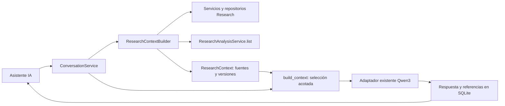

# Contexto de investigación en el chat — Sesión 16A

Implementado el 2 de noviembre de 2026 sobre `develop` (`d772780`, PR #27).
Rama: `feat/contexto-investigacion-chat`. Presupuesto de servicios: **S/ 0**.

## Objetivo y alcance

El Asistente IA recibe información persistida del proyecto seleccionado para responder
sobre su investigación. Cada nuevo turno vuelve a consultar las fuentes actuales. Se
conservan el historial, Markdown, CRUD, paginación, aislamiento y control de reintentos de
la Sesión 15A. La llamada normal sigue utilizando el adaptador existente de Qwen3 en
Cloudflare Workers AI: una llamada por turno, sin resúmenes generados con otra llamada.

El chat consulta fuentes: no extrae documentos, genera paquetes, propone, aprueba ni
ejecuta estadísticas. No se implementan LangGraph, tres agentes ni la Sesión 17A.

## Arquitectura



`research_context.py` es un adaptador de lectura dentro de Conversation. Consume
interfaces existentes; no consulta tablas internas de Research o Statistics ni duplica
sus validaciones, fórmulas o planificación. `dev_app.py` compone los servicios existentes
con el constructor. `app.main` y los seis contratos v1.0.0 no cambian.

`ContextSource` contiene `kind`, `id`, `status`, `version`, `links` y hechos `data`.
`ResearchContext` añade el proyecto y una huella SHA-256 del conjunto serializado.
`GET /conversations/status` devuelve el título y las referencias/estados locales, sin
enviar una solicitud al proveedor. No acepta IDs de fuentes elegidos por el cliente.

## Fuentes y criterios de inclusión

| Fuente | Interfaz de lectura | Información seleccionable |
| --- | --- | --- |
| Proyecto | `ProjectService.get` | ID, título y programa; se excluyen descripción y otros datos innecesarios |
| Metodología | `DocumentService.list` y `MethodologyRepository` | Objetivos, hipótesis, variables, roles, escalas, dimensiones, indicadores, instrumentos, diseño y aclaraciones |
| Población/muestra | `additional_methodology` de la revisión; `sampling_notes` del paquete | Solo texto realmente registrado; no se deducen campos inexistentes |
| ResearchPackage | `PackageService.validate/get_package` | Solo paquete generado vigente: objetivos/hipótesis vinculados, variables, columnas, diseño, observaciones y preguntas pendientes |
| Dataset | `DatasetService.list` | Dataset activo, nombre, filas, columnas, procedencia original/derivado y cantidad de advertencias |
| EDA | Repositorio EDA y `EDAService.get` | Resumen agregado, tipos sugeridos, faltantes, duplicados y advertencias de calidad de columnas permitidas |
| Preparación | `PreparationRepository.list` | Tipos de operaciones aplicadas, filas retiradas y celdas cambiadas; no valores de reemplazo ni previews |
| Plan/resultados | `ResearchAnalysisService.list` | Técnica, justificación, aprobación, aclaraciones, ejecución, métricas, supuestos y texto persistidos permitidos |

La revisión debe tener `review_status=reviewed` y `reviewed_at`. Si es borrador, se
envían únicamente su estado y campos pendientes, no sus objetivos o hipótesis. Los
campos desconocidos no se convierten en hechos. Varias revisiones se conservan como
fuentes distintas; las instrucciones exigen aclarar discrepancias.

El tipo de análisis previsto procede de las hipótesis vinculadas (`kind`) y de los
planes existentes. No se inventa una técnica a partir de una pregunta.

## Versiones, vigencia y resultados históricos

- Metodología: versión de revisión; guardar una edición retira la confirmación. Solo
  volver a confirmar habilita sus hechos como confirmados.
- Paquetes: se reutilizan comprobaciones existentes de revisión, versión y hash,
  dataset activo, hash de datos, configuración y versión de construcción.
- EDA: `EDAService.get` verifica hash del dataset y versión de reglas. Un perfil
  inexistente o desactualizado solo aporta su estado, sin cifras antiguas.
- Estadísticas: `ResearchAnalysisService.list` verifica paquete, documento,
  configuración, token de propuesta y dataset; puede persistir la invalidación ya
  implementada por ese servicio. Consultar no calcula ni aprueba.
- Resultados: se comprueban proyecto del registro, paquete del plan, hipótesis,
  dataset del plan y vínculo resultado–plan–dataset. Una asociación incompatible se
  excluye. Un resultado vigente completado requiere aprobación y ejecutabilidad
  consistentes; los registros incoherentes son `unverified`, sin métricas.
- Resultados fallidos/no ejecutados nunca aportan métricas, aunque existan valores
  incoherentes guardados en el registro.
- Un resultado anterior puede aportar métricas con estado **historical** y su dataset
  y plan originales, sin atribuirse al dataset activo ni reconstruir datos desde el
  paquete histórico. Planes propuestos y aprobados no implican ejecución.

La construcción y los servicios de vigencia pueden leer bytes **localmente para
calcular/verificar hashes**. El constructor no solicita previews, itera filas, vuelve
a perfilar ni interpreta documentos. Esos bytes nunca forman parte del prompt.

Cada respuesta nueva conserva en `Message.context`: huella de fuentes, referencias
seleccionadas, campos seleccionados, omisiones, turnos incluidos y alcance del
consentimiento. La columna SQLite `context` se añade de forma aditiva: mensajes
anteriores permanecen con `context=null`. Los reintentos idempotentes devuelven la
respuesta y trazabilidad originales, sin llamar otra vez al proveedor.

Si un mensaje anterior carece de trazabilidad o utiliza una huella diferente, se
marca `history_changed` y se instruye al modelo a advertirlo. El historial se conserva
íntegro en SQLite; solo se seleccionan pares completos recientes para el proveedor.

## Selección y límites de contexto

1. Se reservan instrucciones y mensaje actual completos; si no caben, se devuelve
   `input_limit` sin llamar al proveedor.
2. Se incluye un resumen de estados de fuentes y una huella del estado consultado.
3. Se priorizan hechos según palabras de la pregunta: objetivos, hipótesis, variables,
   metodología, dataset/calidad o resultados. Para resultados se priorizan métricas,
   advertencias y supuestos. Fuentes actuales preceden a históricas.
4. Los hechos se incorporan completos. Las listas pueden seleccionar elementos
   completos; no se cortan textos, valores numéricos ni objetos a la mitad. El total
   omitido es explícito en el prompt y en la interfaz de procedencia.
5. Los hechos no esenciales reservan hasta 2.000 bytes (25 % del presupuesto como
   máximo) para continuidad conversacional. El historial se añade después, por pares
   completos, con hasta ocho turnos por defecto. Los hechos relevantes pueden agotar
   el espacio; el historial completo sigue disponible localmente.

Presupuesto efectivo en bytes UTF-8:

```text
min(CONVERSATION_MAX_CONTEXT_BYTES,
    CLOUDFLARE_MAX_INPUT_TOKENS - output_tokens - 512)
```

Se conserva la cota conservadora del adaptador existente: bytes como límite superior
operativo de tokens, con margen para la envoltura de transporte y la respuesta. Por
defecto: 10.000 bytes de contexto y hasta 1.024 tokens de respuesta. No se añaden
tokenizadores, llamadas para resumir ni proveedores adicionales.

Los datos académicos están en un bloque `DATOS_JSON` explícito, separado del texto
de instrucciones. Los títulos, variables, documentos y mensajes son datos no confiables.
Su contenido no cambia roles de API ni obtiene herramientas. Las instrucciones exigen
separar hechos del proyecto, explicación académica e información desconocida, citar
solo referencias proporcionadas y no inferir significancia a partir de `r` y `n`.

## Privacidad y consentimiento

Cada POST de mensajes requiere ambos campos:

```json
{
  "content": "¿Cuál es mi objetivo general?",
  "request_id": "37ae1f8e-93b8-4f20-8dbf-d559edc2d847",
  "external_ai_consent": true,
  "consent_scope": "research_context_v2"
}
```

Un cliente anterior que solo envía el consentimiento v1 recibe 422 antes de reservar
el turno o acceder al proveedor. El checkbox se presenta desmarcado en cada montaje;
no reutiliza permisos de `sessionStorage`. El aviso describe mensaje, título, historial,
metodología seleccionada, metadatos y métricas verificadas. Sin aceptar, se permite
leer y organizar el historial local. La trazabilidad guarda el alcance aceptado.

Se excluyen documentos completos, archivos binarios, filas, previews, frecuencias de
categorías, ejemplos incompatibles, extremos del perfil EDA y valores de preparación.
Los nombres de columnas potencialmente identificadoras y las métricas con categorías
o etiquetas individuales se excluyen mediante listas permitidas/filtros. Los supuestos
con nombres que incorporan etiquetas de grupos también se omiten. Se informan los
recuentos de métricas/supuestos omitidos. Correos y secuencias con forma de identificador
en texto académico se enmascaran como defensa adicional, preservando UUID internos y
valores decimales. Las métricas numéricas no se redondean ni modifican.

**Esto no es anonimización garantizada.** Los nombres propios y datos personales
incluidos en prosa libre no pueden detectarse de forma exhaustiva. Sigue siendo una
demostración sin autenticación ni autorización entre usuarios, solo loopback y datos
ficticios. El aislamiento por proyecto no reemplaza controles de acceso reales. No se
leyeron ni imprimieron credenciales para desarrollar/verificar esta sesión. No hubo
solicitudes reales a Cloudflare, compras, nuevos servicios ni consumo de créditos.

## Frontend

El panel «Contexto de investigación» muestra proyecto y estados de metodología,
dataset, EDA, preparación, paquete, planes y resultados, con explicaciones de ausencia,
borrador, incompletitud e historia. Se actualiza al montar, volver a enfocar la ventana,
usar «Actualizar contexto» y completar un envío. La verificación del backend siempre
ocurre otra vez al enviar, aunque el panel aún muestre el último estado consultado.

Cada respuesta tiene un desplegable de fuentes proporcionadas por el backend. Estas
son **fuentes enviadas al modelo**, no una afirmación de que utilizó todas. Se indican
omisiones y diferencias respecto al estado actual. Un fallo al consultar estados no
bloquea cargar el historial. Se mantienen las conversaciones separadas por proyecto y
el formato Markdown seguro. La demo especial se identifica como proveedor simulado.

## Archivos y límites de integración

| Archivo o grupo | Cambio |
| --- | --- |
| `backend/app/modules/conversation/research_context.py` | Constructor, filtros, procedencia y estados |
| `backend/app/modules/conversation/context.py` | Selección relevante, límites e instrucciones |
| `models.py`, `ports.py`, `sqlite_repository.py` de Conversation | Alcance v2 y trazabilidad persistida/migración |
| `backend/app/modules/conversation/service.py` | Reconstrucción por turno, status ampliado y presupuesto |
| `backend/app/modules/research/dev_app.py` | Composición de dependencias |
| `backend/scripts/demo_context_chat.py` | Demostración reproducible sin red ni IA real |
| `backend/tests/research/test_conversation_context.py` | Pruebas nuevas de fuentes/vigencia/privacidad |
| `backend/tests/research/test_conversation.py` | Consentimiento v2 y expectativas del contexto ampliado, conservando pruebas previas |
| `frontend/src/features/conversation/` | Panel, consentimiento, tipos, procedencia y pruebas |
| `README.md`, `docs/CHAT_CONVERSACIONAL.md` | Referencias y alcance vigente |

No se modificaron `analysis_service.py`, `analysis_inputs.py`, el bridge, fórmulas,
planificador, catálogo, informes, componentes Statistics ni contratos compartidos.

## Ejecución normal

Los comandos habituales del README continúan vigentes: API Research en 8001 y Vite
en 5173. Reinicia el backend después de cambiar código. La configuración existente de
Qwen3 se conserva, sin imprimir o editar secretos. **No envíes mensajes reales durante
la revisión sin autorizar expresamente la transmisión ampliada.**

## Validación reproducible con proveedor simulado

En una terminal desde `backend/`:

```powershell
uv run python -m scripts.demo_context_chat
```

En otra terminal desde `frontend/`:

```powershell
$env:VITE_RESEARCH_API_BASE_URL='http://127.0.0.1:8016'
npm run dev -- --port 5176
```

Abre [la demo aislada](http://127.0.0.1:5176/). Usa exclusivamente la base y archivos
de `.cache/context-chat-demo/`; no reemplaza tus proyectos habituales. El script
crea dos proyectos ficticios solo si la base está vacía. El primero tiene metodología
confirmada, CSV de 4 filas/2 columnas, EDA, paquete y Pearson **realmente calculado por
el motor local** (`r=1`, `n=4`) mediante propuesta y aprobación fuera del chat. El
segundo está vacío. Reiniciarlo conserva los cambios y conversaciones.

El proveedor simulado muestra hechos seleccionados de forma determinista y se
identifica en cada respuesta. **No es una respuesta generada por Qwen3**, ni prueba
de su capacidad interpretativa. Nunca abre un transporte externo.

Procedimiento manual:

1. Abre «Demostración sintética 1» → «Asistente IA» → «Nueva conversación».
2. Verifica estados de fuentes y acepta el aviso para la prueba simulada.
3. Pregunta por objetivo, hipótesis, variables y dimensiones. Deben coincidir con
   la revisión sintética; cada hecho conserva su documento y versión.
4. Pregunta por filas/columnas: 4 y 2. Pregunta por Pearson: `n=4`, `r=1`; no hay
   p-valor de la correlación ni conclusión de significancia.
5. Abre las referencias de una respuesta. Contrasta el ID del resultado con el plan
   persistido en la sección Paquete/Resultados.
6. Edita y guarda la hipótesis en Documento/Metodología. Vuelve al chat y actualiza
   el contexto: metodología en borrador, paquete desactualizado y resultados históricos.
   La hipótesis pendiente no debe ser un hecho confirmado de la siguiente consulta.
7. Confirma la nueva metodología; pregunta otra vez. La nueva revisión puede usarse,
   pero el paquete y análisis anteriores siguen requiriendo actualizar su flujo.
8. Activa otro dataset ficticio. Comprueba cambio de filas/columnas, EDA faltante y
   que las métricas anteriores conservan el ID del dataset histórico.
9. Recarga con F5: historial conservado y consentimiento nuevamente desmarcado.
10. Cambia a «Demostración sintética 2»: fuentes ausentes y sin conversaciones del primero.

Se realizó el recorrido en navegador integrado: consultas de los pasos 1–5, edición
de hipótesis vía API local y actualización visible del paso 6, F5 y aislamiento del
paso 10. Se contrastaron las métricas con el GET de planes persistidos. Los cambios
de dataset, reconfirmación, preparación y fallos de proveedor también se verifican
automáticamente. La validación semántica con **Qwen3 real queda pendiente** de
autorización y revisión humana; esta sesión no la ejecutó.

## Pruebas y regresión

La suite utiliza investigaciones sintéticas y proveedores/transportes simulados.
`test_conversation_context.py` cubre las fuentes confirmadas y pendientes, objetivos,
hipótesis, variables/dimensiones, EDA vigente/ausente/obsoleto, paquetes, propuesta y
aprobación, resultados completados/fallidos/históricos, relaciones incompatibles,
proyectos ajenos, inyección de instrucciones, límites, edición entre turnos, cambio
de datos, exclusión de filas/categorías/identificadores, trazabilidad tras reinicios,
migración antigua y ausencia de ejecución automática. También verifica preparación
y la demo repetible sin red. La suite anterior conserva errores/configuración del
proveedor, idempotencia, concurrencia y CRUD.

Las pruebas frontend incluyen estados y actualización de fuentes, consentimiento
ampliado, historial pese a error de status, procedencia tras recarga y actualización al
recuperar foco, además del comportamiento anterior y la navegación Research.

Regresión ejecutada en Windows con las dependencias locales existentes:

| Comprobación | Resultado |
| --- | --- |
| `uv run pytest -q` | **334 aprobadas**, 142,95 s |
| Contexto nuevo + regresión anterior del chat | **84 aprobadas**: 36 nuevas y 48 anteriores |
| `uv run ruff check .` | Correcto, sin incidencias |
| `uv run ruff format --check .` | 128 archivos con formato correcto |
| `uv run python -m scripts.export_contracts --check` | Correcto; seis contratos sin cambios |
| `uv run python -m compileall -q app scripts tests` | Correcto |
| `npm test` | **94 aprobadas** en 19 archivos, 11,64 s |
| Pruebas de conversación frontend | **26 aprobadas** en 2 archivos |
| `npm run lint` | Correcto, cero advertencias permitidas |
| `npm run format:check` | Correcto |
| `npx tsc -b` y `npm run build` | Correctos; tres entradas: app, Research y Statistics |
| `npm run build:research` | Correcto, demo independiente |
| `npm run contracts:generate` + diff de contratos/generados | Sin diferencias |
| `git diff --check` | Correcto |

No se eliminaron pruebas previas. Se actualizó el payload de las pruebas 15A para
declarar el consentimiento ampliado y el presupuesto de su caso de entrada reducida
para contemplar las nuevas instrucciones/estados. La regresión de todas las funciones
anteriores sigue pasando. Los resultados locales no equivalen a GitHub Actions;
el estado de CI y el enlace del PR se entregan en el informe final de publicación.

## Limitaciones y preparación de la Sesión 17A

- Selección determinista por palabras clave, sin búsqueda semántica ni resúmenes con IA.
- Un hecho individual demasiado grande se omite completo; se informa la omisión.
- Las referencias de UI son verificadas por backend; el texto libre del modelo requiere
  revisión y puede contener errores. No hay verificador semántico de respuestas o citas.
- Los filtros son conservadores: omiten métricas/supuestos con etiquetas que podrían
  contener datos individuales. No garantizan anonimización de prosa arbitraria.
- No hay transacción única entre todos los módulos: la huella representa las lecturas
  realizadas para el turno. Una edición concurrente posterior aparecerá como un estado
  nuevo al consultar de nuevo; no se reescribe una respuesta ya generada.
- El estado del panel es el último consultado, no una suscripción en tiempo real.
- Sin autenticación, despliegue, servicios de pago, técnicas nuevas, ejecución desde
  el chat, planificación multiagente o evidencias finales para Notion.

El constructor y la trazabilidad dejan una entrada estructurada reutilizable para
la futura planificación de la Sesión 17A, que debe implementarse y revisarse aparte.
