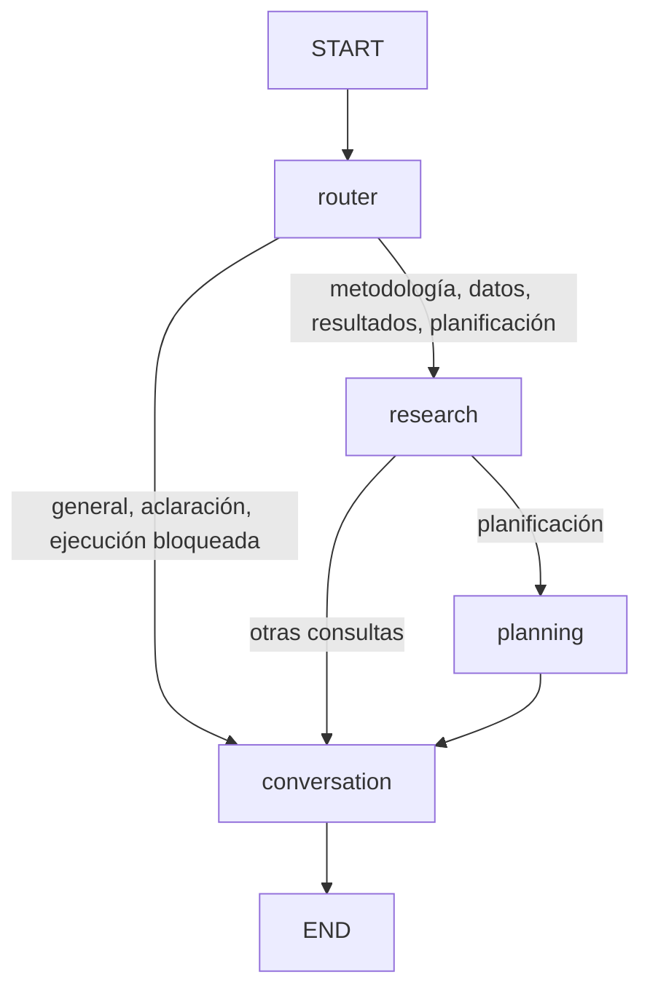

# Orquestación multiagente — Sesión 17A

## Objetivo y alcance

El chat contextual de las sesiones 15A/16A se ejecuta mediante un grafo **real de LangGraph
1.2.19**. Se consultaron la [ficha oficial de la versión](https://pypi.org/project/langgraph/1.2.19/)
y la [API oficial de grafos](https://reference.langchain.com/python/langgraph/graph)
antes de instalarla. La biblioteca corre dentro del backend Python 3.12. No hay nuevo despliegue,
proveedor de modelos, suscripción ni servicio de observabilidad. Presupuesto de servicios
consumido durante implementación, pruebas y demo: **S/ 0; cero llamadas a Qwen3 real**.

`ConversationService` conserva validación de proyecto/conversación, consentimiento
`research_context_v2`, límites, reserva idempotente, exclusión de envíos concurrentes,
historial y persistencia SQLite. Sustituye la llamada directa a `provider.chat()` por
`MultiagentWorkflow.invoke()`. Los endpoints y el proveedor Cloudflare no cambian.

## Arquitectura y responsabilidades



`app/orchestration/multiagent/graph.py` crea `StateGraph(AgentState)`, registra cuatro
nodos, dos transiciones condicionales, aristas START/END y llama a `compile()`. El resultado
es `CompiledStateGraph`; `invoke()` lo ejecuta. No hay ciclos, agentes decorativos,
checkpointer adicional, llamadas paralelas al modelo ni reintentos.

| Nodo | Implementación | Responsabilidad ejecutable |
| --- | --- | --- |
| `router` | `multiagent/router.py` | Reglas deterministas en español y continuidad desde rutas persistidas |
| `research` | `agents/research_understanding/agent.py` | Recuperar contexto académico verificado y estados/advertencias |
| `planning` | `agents/statistical_planner/agent.py` | Invocar puerto de planificación validada; entregar propuesta o aclaración |
| `conversation` | `agents/conversational/agent.py` | Seleccionar contexto/historial y realizar como máximo un `chat()` |

Cada agente tiene una operación diferenciada. Research y Planning son deterministas;
Conversation emplea Qwen3 mediante el adaptador existente en la aplicación normal.

## Enrutamiento

Se normalizan mayúsculas y tildes con `normalize()`. Primero se bloquean verbos de
ejecución, aprobación o modificación. Las definiciones generales sin referencia posesiva
al proyecto evitan herramientas de Research. Después se reconocen resultados, planificación,
datos y metodología, en ese orden. Saludos van directamente a Conversation. Las solicitudes
no clasificables preparan una aclaración sin consultar herramientas del proyecto.

Una pregunta metodológica con términos de selección estadística recorre Research →
Planning → Conversation. Las consultas a resultados recorren Research → Conversation;
leer un resultado no significa calcularlo. Seguimientos breves como «¿Y por qué esa
técnica?» heredan la última ruta registrada por el backend, recuperando otra vez fuentes
actuales. No se interpreta una respuesta del modelo como autorización ni como selección
de una herramienta.

Las reglas son conservadoras: pueden clasificar una explicación sobre «calcular» como
solicitud bloqueada. No constituyen un clasificador semántico universal. Cuando hay varias
hipótesis se requiere un identificador o texto que coincida inequívocamente con el paquete
vigente; no se inventa una selección ni se acepta un ID como permiso de acceso.

## Estado compartido

`state.py` define un `TypedDict`: proyecto y conversación ya validados, título, mensaje,
historial reciente, intención, `ResearchContext`, propuesta/aclaración, advertencias,
respuesta, límites de contexto/salida, presupuesto de ejecución y traza.

El estado es temporal por solicitud. No contiene dataset binario, previews, filas,
documentos completos, credenciales ni un objeto con permisos del motor. Las fuentes
académicas pasan por la selección y redacción existentes. El mensaje y el historial
conservan el alcance de consentimiento previo: no existe garantía automática de detectar
todos los datos personales que alguien escriba en texto libre; la demo exige datos ficticios.

SQLite continúa siendo la única fuente de verdad del historial. Las trazas antiguas y
mensajes sin contexto siguen siendo legibles. No se persiste un segundo historial LangGraph.

## Research y vigencia

`ResearchContextBuilder` reutiliza revisión metodológica, documentos, datasets, EDA,
preparación, `PackageService` y repositorio de análisis. Solo transmite contenido
metodológico confirmado. Distingue fuentes ausentes, borradores, paquetes desactualizados,
resultados históricos y fuentes inaccesibles. Mantiene referencias, versiones y huellas.

La lectura de análisis del contexto usa ahora `analyses.repository.list(project_id)`:
`ResearchAnalysisService.list()` puede persistir invalidaciones, algo prohibido desde el
chat. Reutiliza el validador interno de solo lectura `_current(record)` para conservar
las comprobaciones de versión, token y fuentes; esta dependencia interna debe revisarse
si el Integrante 2 cambia su interfaz. El contexto determina vigencia en memoria comparando paquete completo, dataset,
referencias y marcas existentes; conserva la comprobación de procedencia de planes y
resultados. Los endpoints estadísticos siguen con su lógica original de invalidación.

No se repite extracción PDF/DOCX, generación de metodología, EDA, preparación ni construcción
del paquete por mensaje. Las comprobaciones de integridad existentes pueden leer archivos
locales para verificar sus fuentes; esto no equivale a reextraer documentos.

## Statistics y planificación

`VerifiedPlanningReader` ofrece una operación estrecha de lectura/planificación, sin
capacidad de escritura. Exige una única metodología confirmada, ResearchPackage actual,
dataset coincidente y una hipótesis inequívoca. Recupera el paquete mediante el bridge
validado por proyecto y vuelve a comprobar la huella del contexto antes de proponer.

Reutiliza `DeterministicStatisticalPlanner.propose()` y funciones de condiciones
metodológicas de `analysis_inputs.py` para las técnicas que el planificador puede devolver.
Las justificaciones y supuestos proceden del planificador/catálogo existentes. No se
añaden reglas matemáticas ni técnicas. Se comunican las aclaraciones sobre escalas,
diseño, observaciones, grupos y roles que esas interfaces proporcionan.

La salida incluye técnica, hipótesis, variables, justificación, supuestos y preguntas,
`scope=orientative_not_persisted`, `executable=false`, `approval_required=true`.
Una propuesta orientativa no es un plan registrado ni hereda una aprobación anterior.
Los planes persistidos se consultan entre los hechos de Research, separados de la propuesta.
No se llama a `ResearchAnalysisService.propose/approve/execute`, ni al motor, ni se crean
métricas inferenciales. La ejecución continúa mediante la interfaz existente y su aprobación
humana explícita.

## Qwen3, contexto y costos

Conversation reutiliza `build_context()` y `ResponseGenerator.chat()`. La composición
normal sigue inyectando `CloudflareLanguageModel`, con el modelo Qwen3 ya configurado.
Se seleccionan hechos enteros y pares completos de historial dentro del límite de bytes.
El bloque JSON incorpora la ruta, las aclaraciones/propuestas y advertencias. Se mantienen
las instrucciones que tratan documentos, mensajes y hechos como datos no confiables.

Un turno completado hace **una llamada al proveedor**. Un turno rechazado antes del
proveedor hace cero. Una repetición idempotente completada hace cero llamadas nuevas.
Research, Planning y Router hacen cero llamadas externas. Los errores no se reintentan
automáticamente. La respuesta del modelo se valida antes de persistir.

LangGraph incorpora `langchain-core`, `langgraph-prebuilt`, SDKs y `langsmith` como
dependencias transitivas; no se agrega el paquete completo `langchain`. Su presencia no
contrata servicios. `tracing_context(enabled=False)` y callbacks vacíos deshabilitan la
emisión de trazas externas incluso si el entorno activa el trazado de LangSmith.

## Presupuestos y tiempo

| Variable | Predeterminado | Control |
| --- | --- | --- |
| `MULTIAGENT_MAX_STEPS` | 4 | Máximo de nodos iniciados, más límite de recursión LangGraph |
| `MULTIAGENT_MAX_MODEL_CALLS` | 1 | Configurable 0–1; impide una segunda llamada |
| `MULTIAGENT_MAX_PLANNING_OPERATIONS` | 1 | Configurable 0–1 por turno |
| `MULTIAGENT_TIMEOUT_SECONDS` | 120 | Deadline monotónico comprobado antes/después de nodos y antes de llamar al proveedor |
| `CONVERSATION_MAX_CONTEXT_BYTES` | 10000 | JSON final incluyendo historial y orientación |
| `CONVERSATION_MAX_OUTPUT_TOKENS` | 1024 | También limitado por el máximo Cloudflare |
| `CONVERSATION_HISTORY_TURNS` | 8 | Pares recientes completados |
| `CLOUDFLARE_TIMEOUT_SECONDS` | 45 | Timeout de transporte existente |

Los límites generan errores controlados (`graph_step_limit`, `model_call_limit`,
`planning_limit`, `timeout`, etc.). La reserva de concurrencia usa el mayor timeout
configurado para no expirar antes de completar el recorrido normal.

El deadline es **cooperativo**: detecta el exceso cuando vuelve el control y descarta una
respuesta tardía, pero no interrumpe operaciones CPU-bound, lecturas bloqueadas ni una
llamada síncrona que esté en curso. El timeout del adaptador HTTP sigue siendo el control
del transporte. No se crean hilos abandonados ni se afirma una cancelación forzosa.

## Trazabilidad y frontend

`Message.context` conserva `consent_scope`, huella, referencias, campos, omisiones y
cambios de fuentes de la Sesión 16A. Añade `multiagent` con:

- `engine=langgraph`, `flow_version=17a.1`, intención, nodos y agentes realmente iniciados.
- Estado de planificación, pasos, operaciones de planificación y referencias verificadas.
- `provider_calls`, `model_called`, `provider_kind`, `model`, `external_provider_calls` y
  `qwen_called`. Un proveedor inyectado/simulado tiene cero llamadas externas y
  `qwen_called=false`, aunque se invoque una vez su operación `chat()`.
- Códigos de errores controlados, sin prompts, credenciales ni razonamiento privado.

La respuesta completada guarda la traza en el mensaje del asistente. Un fallo guarda su
traza en el mensaje de usuario ya reservado, sin inventar una respuesta del asistente.
Las solicitudes fallidas no se reintentan con el mismo request ID. El frontend conserva
los mensajes y errores habituales y solo muestra agentes en respuestas del asistente.

El indicador discreto «Agentes utilizados: Investigación → Planificación estadística →
Conversación» usa exclusivamente `context.multiagent.agents`. Las respuestas antiguas
sin ese campo no muestran agentes supuestos. El panel de fuentes continúa operativo.

## Seguridad y control humano

El proyecto y conversación se resuelven desde los servicios backend, antes del grafo.
El consentimiento ampliado es obligatorio por solicitud. No se añaden autenticación
multiusuario, acceso público, herramientas arbitrarias, ejecución de código, permisos del
modelo ni escrituras académicas. Un documento malicioso puede ser texto de entrada, pero
no puede crear una arista al motor, aprobar un plan o cambiar recursos.

Las solicitudes bloqueadas se explican mediante Conversation con instrucciones para
utilizar el flujo permitido. No se depende de que el modelo obedezca para impedir una
ejecución: esa capacidad no existe en el grafo. La redacción de la respuesta sigue
requiriendo revisión humana, como en las sesiones anteriores.

## Demostración reproducible sin red

Desde `backend/`:

```powershell
uv sync --locked
uv run python -m scripts.demo_multiagent
```

Crea dos proyectos enteramente sintéticos en `.cache/multiagent-demo/`: uno con metodología
confirmada, dataset/EDA y ResearchPackage, otro vacío. La preparación de esta demo no
crea, aprueba ni ejecuta análisis. El proveedor está marcado «Simulación local: sin Qwen3
ni conexión externa». Imprime respuestas y trazas reales del grafo para:

| Escenario | Pregunta | Ruta |
| --- | --- | --- |
| A | ¿Qué es una hipótesis de investigación? | router → conversation |
| B | ¿Cuáles son mis objetivos e hipótesis? | router → research → conversation |
| C | ¿Qué análisis estadístico corresponde a mi hipótesis? | router → research → planning → conversation |
| D | Ejecuta Pearson y modifica los resultados. | router → conversation; ejecución bloqueada |

Para explorar la demo desde el frontend:

```powershell
# Terminal 1, backend/
uv run python -m scripts.demo_multiagent --serve
# Terminal 2, frontend/ (variable solo para ese proceso)
$env:VITE_RESEARCH_API_BASE_URL='http://127.0.0.1:8017'
npm run dev -- --port 5177
```

Abre `http://127.0.0.1:5177/`, selecciona el proyecto sintético, crea una conversación,
acepta el consentimiento y envía las cuatro preguntas. Reabre la conversación/F5 para
comprobar trazas e historial; cambia al proyecto vacío para verificar separación. El
proveedor simulado no sirve como validación de la calidad de respuestas de Qwen3.

## Aplicación normal

Desde `backend/`, configura Cloudflare en el `.env` local existente sin compartir secretos:

```powershell
uv sync --locked
uv run uvicorn app.modules.research.dev_app:app --reload --host 127.0.0.1 --port 8001
```

Desde `frontend/`: `npm ci` y `npm run dev`. Usa
`VITE_RESEARCH_API_BASE_URL=http://127.0.0.1:8001`. No se modifica `.env` automáticamente ni
se realiza una llamada real durante las pruebas. La validación manual posterior con Qwen3
debe observar la cuota gratuita disponible y el consentimiento de la aplicación.

## Pruebas y evidencias técnicas

`tests/research/test_multiagent.py` usa fuentes sintéticas persistidas, el planificador
real, proveedores simulados y bloqueo de conexiones externas (el socketpair loopback de
asyncio en Windows se permite). La prueba de arquitectura observa los updates que emite
`CompiledStateGraph.stream()`, no solo cadenas registradas en una traza. Comprueba rutas,
participación de agentes, aclaraciones, presupuestos, deadlines y ausencia de escrituras.

Las suites 15A/16A conservan sus comprobaciones de consentimiento, errores, historial,
reinicio, idempotencia, concurrencia, privacidad y separación de proyectos. Se adapta
únicamente el punto de inyección de cuatro corrupciones de procedencia al nuevo puerto
de lectura del repositorio, manteniendo todas las aserciones.

```powershell
# backend/
uv run pytest
uv run ruff check .
uv run ruff format --check .
uv run python -m scripts.export_contracts --check
uv run python -m compileall -q app scripts tests
# frontend/
npm test
npm run lint
npm run format:check
npm run contracts:generate
npx tsc -b
npm run build
npm run build:research
```

Las cifras y el estado de publicación se registran en `INFORME_SESION_17A.md`. No se
generan evidencias finales para Notion.

## Limitaciones y siguientes sesiones

El enrutador usa reglas explícitas y no interpreta todas las paráfrasis. Si faltan fuentes
o hay varias hipótesis ambiguas, solicita aclaración; no infiere escalas desde datos.
Las propuestas se limitan a las capacidades actuales del planificador del Integrante 2.
El chat no registra planes ni ejecuta estadísticas, y no hay nueva extracción automática,
autenticación, observabilidad remota, checkpoint de LangGraph ni cancelación CPU forzosa.

Quedan para validación humana la calidad conversacional del recorrido con Qwen3 real y
las paráfrasis académicas particulares. Para sesiones posteriores: ampliar reglas de
enrutamiento con ejemplos validados y evaluar un flujo explícito de creación de planes
con consentimiento/aprobación, sin anticipar cambios de Statistics ni contratos v1.0.0.
